# CEC2005 function set optimal value, average, standard deviation, worst value, median, rank sum test, box plot, commonly used indicators of intelligent optimization algorithms for one-click export to EXCEL

To highlight the effectiveness of improved intelligent optimization algorithms, it is common to compare them with other algorithms.
In some journal papers, one often sees a very large table that summarizes various indicators for each algorithm, such as average values, standard deviations, optimal values, and rank sum tests.
\n        \n      \n        \n
Some papers, in order to present the data more intuitively, will include box plots. For example:
\n        \n
However, if we had to manually count the code repeatedly, it's unlikely that Flash would do it! Today, we will use MATLAB tools to teach everyone how to directly complete the statistical task with one click and export the Excel table, while also plotting boxplots.
The algorithm replacement is very simple; all you need to do is replace the algorithm name! The test set replacement is also very simple!
For this session, we will take the Adaptive Spherical Flight Sparrow Search Algorithm (ASFSSA) as an example, and compare it with the Dung Beetle Optimization Algorithm, Sparrow Optimization Algorithm, Particle Swarm Optimization Algorithm, and Grey Wolf Optimization Algorithm.
We will run each algorithm 30 times in the CEC2005 function for testing, and automatically calculate the optimal value, average, standard deviation, three indicators, and the rank sum test results, while also plotting a boxplot.
The code directory is as follows:
\n        \n
The script "plotCEC2005_Main.m" remains the same as usual, which is a program for comparing different algorithms.
The key point is that when you run the script "runsCEC2005_Main.m", it will generate two Excel files: ranksumresult.xls and result.xls. The former contains the results of the rank sum test, while the latter contains statistics for three indicators. The results are as follows:
ranksumresult.xls table:
\n        \n
result.xls table:
\n        \n
The code in the program has been set to allow for the selection of whether or not box plots should be drawn, and it can also be changed with a single click. The box plot is as follows:
\nPart of the code is shown.
The code for part of the "runsCEC2005_Main.m" file is as follows:
clear\nclc\nclose all\naddpath(genpath(pwd));\npop_size=50;   %Population number\nmax_iter=500;   % Iteration count\n​\nrun = 30;\nbox_pp = 1;  % Optional 1, or other. When equal to 1, draw a box plot, otherwise do not draw.\nRESULT=[];   % Calculate the results such as standard deviation, mean, optimal value, etc.\nrank_sum_RESULT=[];  % Calculate the rank sum test results\n​\nif box_pp ==1\n    figure('Name', 'Box plot', 'Color', 'w','Position', [100 100 1400 700])\nend\n​\nfor func_num = 1:length(F)    %CEC2005 has 23 functions\n    % Display the comprehensive results\n    disp(['F',num2str(F(func_num)),'Function calculation results: '])\n    [lower_bound,upper_bound,variables_no,fhd]=Get_Functions_details(['F',num2str(F(func_num))]);\n    resu = [];  % Calculate the results such as standard deviation, mean, optimal value, etc.\n    rank_sum_resu = [];   % Calculate the rank sum test results\n    box_plot = [];  % Statistical box plot results\n    ……\nend\n%% Write the rank sum test result into elcex\nB = string();\nfor i = 1:length(F)\n    str = string(['F',num2str(F(i))]);\n    B(i,1)= str;\nend\nB = cellstr (B);\nB = [B,num2cell(rank_sum_RESULT)];\ntitle = {" ","DBO","PSO","GWO","SSA"};% The rank sum test is compared with an improved algorithm, hence there is no improved algorithm here.\nB = [title;B];\nxlswrite('ranksumresult.xls', B)\n​\n%% Write the results of standard deviation, mean, optimal value, etc. into elcex.\nA = string();\nA = cellstr (A);\nA = [A,num2cell(RESULT)];\ntitle = {" "," ","ASFSSA","DBO","PSO","GWO","SSA"};\nA = [title;A];\nxlswrite('result.xls', A)\n
Next, let's show you the upgrades in the code compared to the previous article.
Upgrade feature 1: The sub-figure size of box plots is adjusted to be consistent, removing unnecessary white borders, and directly saving high-resolution images to the current folder. Example:
\n        \n      \n        \n
\n        \n      \n        \n
\n        \n
! The images above were not processed by any post-processing method, and were generated purely by MATLAB. They are of a standard size and color scheme!
The code directory is as follows:
\n        \n
After running the code, a high-definition box plot can be directly generated in the current directory, making it convenient to paste into your paper!
Upgrade 2: Any arbitrary addition or deletion of comparison algorithms.
The main function is as follows, very simple and clear! The comments are detailed! Just add or delete the algorithm you want to compare here, no need to change anything else! This is really convenient for those who do not know how to modify the code!
Upgrade 3: One-click selection to draw box plots or perform rank sum tests.
As shown above, simply setting a few variables can switch freely!
Upgrade 4: Add Wilcoxon signed-rank test functionality.
Upgrade 5: Add average adaptive convergence curve drawing functionality.
Many friends may not understand what an average adaptive convergence curve means. As we all know, any intelligent optimization algorithm has some randomness; a single good value found by an algorithm does not necessarily indicate its excellence. Therefore, multiple runs of the algorithm can be adjusted by changing the number of runs in the code, recording each iteration curve during optimization, and finally calculating an average. This curve can better reflect the quality of an algorithm.
Other basic functions, such as five indicator statistics (best value, standard deviation, mean, median, worst value), results of rank sum tests, etc., are not elaborated on here! You can refer to previous articles for detailed introductions: Smart Algorithm Indicator One-Click Statistics for CEC2005 Function Set
Note!!
To protect code copyright, the key function CEC2005_Statistics in this code has been encrypted as a P file, please do not copy it if you mind! For researchers only, the code introduced in this issue is sufficient and does not require learning how to write functions; it can be used as a tool!

## Images

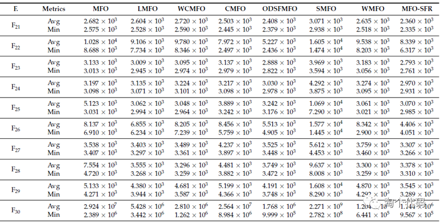
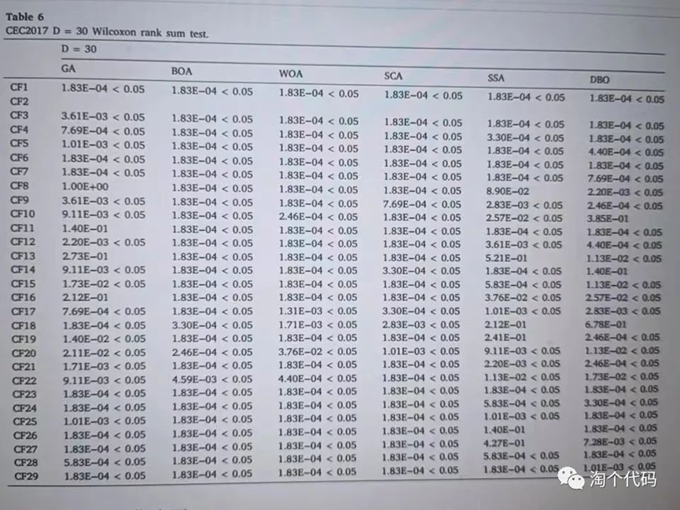
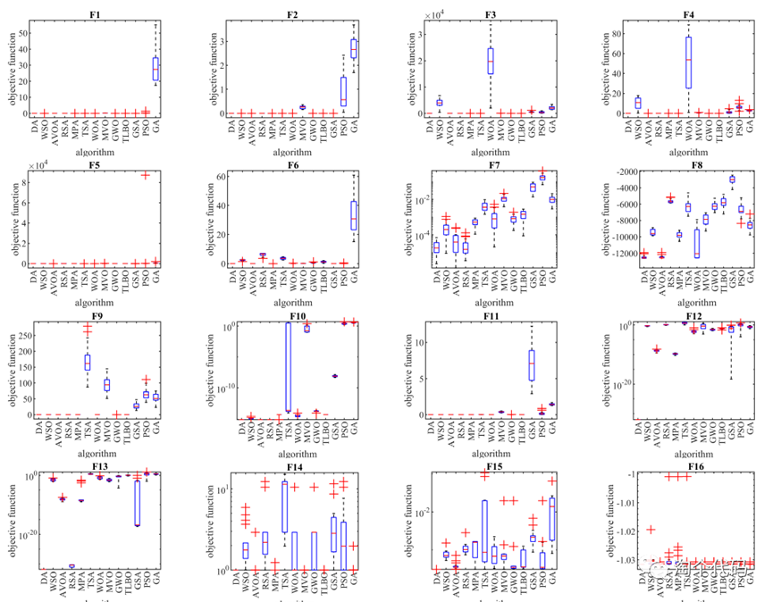
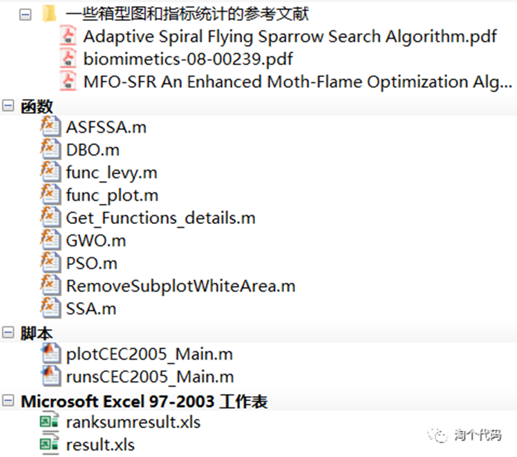
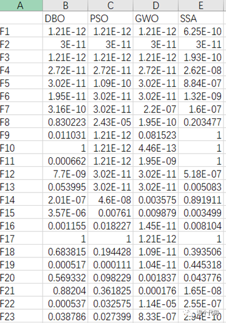
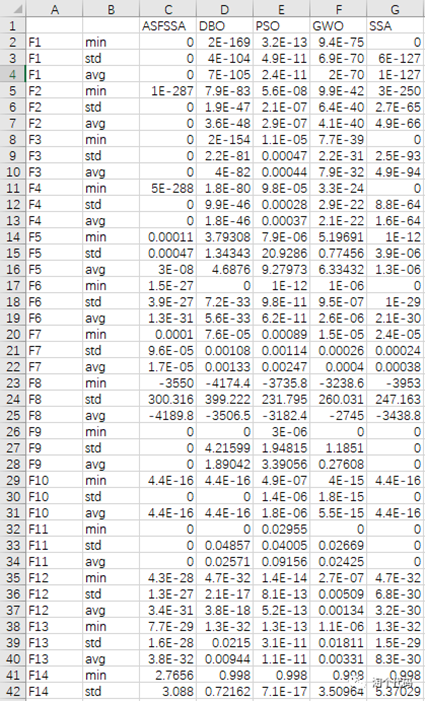
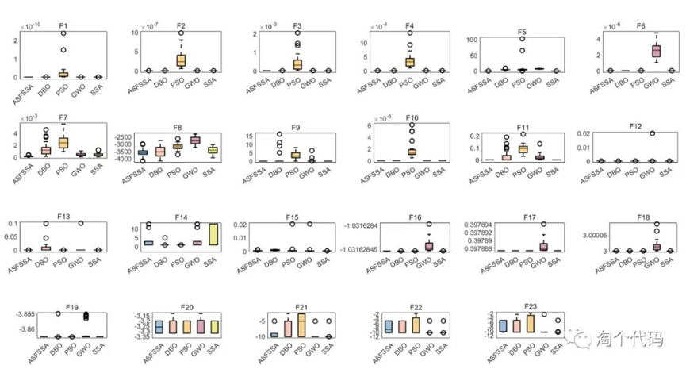
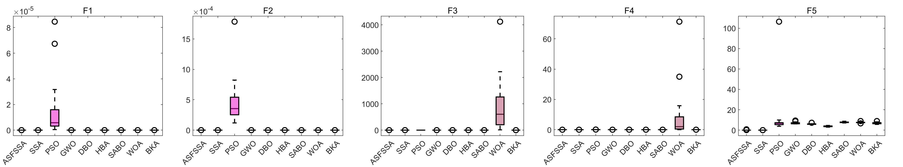
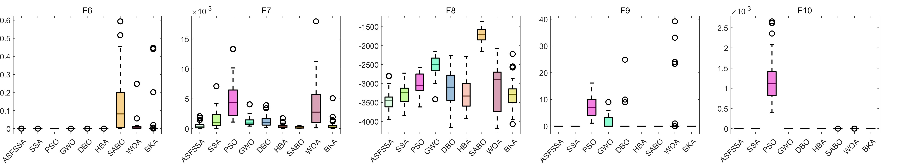
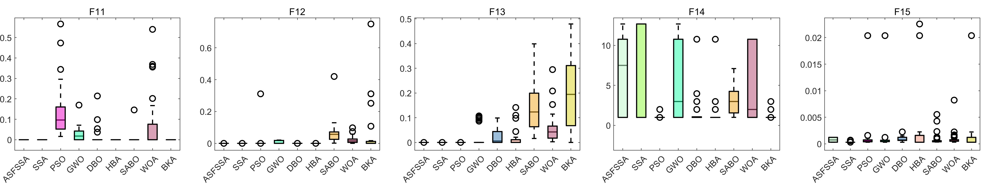
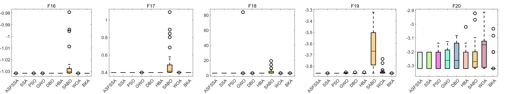
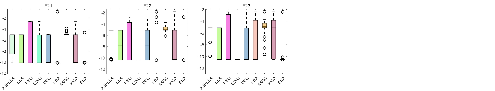
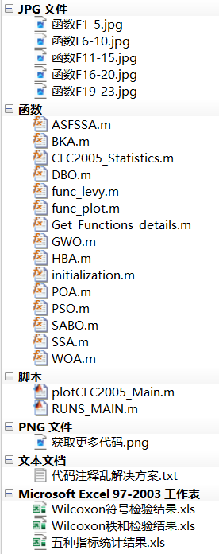
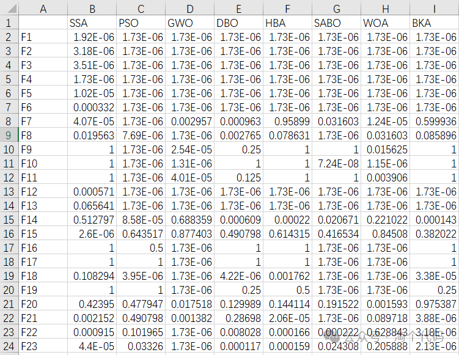
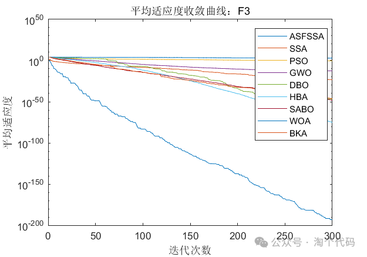
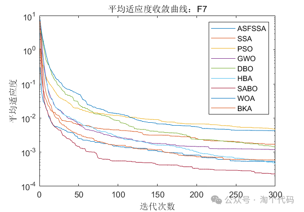
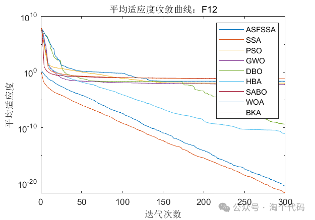

<!-- PAYMENT_BLOCK -->

## Get this dataset

- Payment link (Stripe): [Buy now](https://buy.stripe.com/3cs8yP7sY87d0vu9AB)
- Payment QR code: 

<!-- /PAYMENT_BLOCK -->
